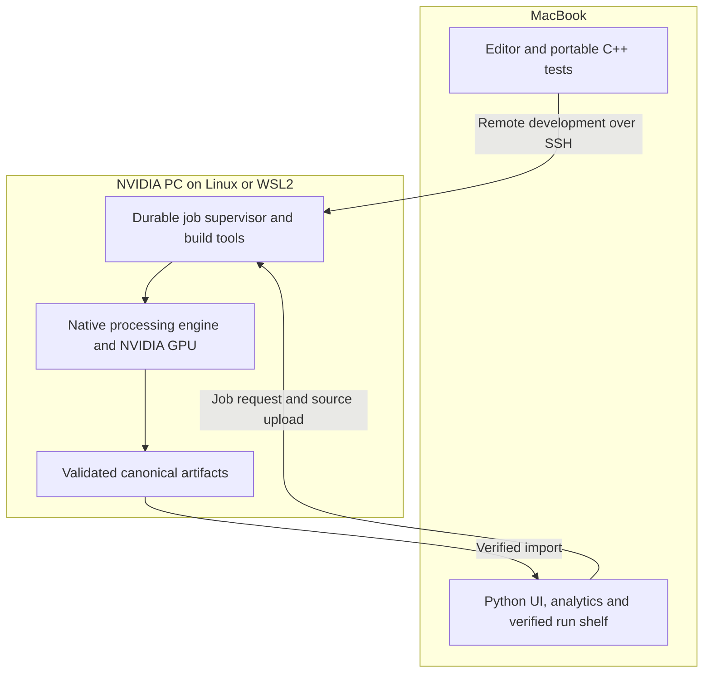
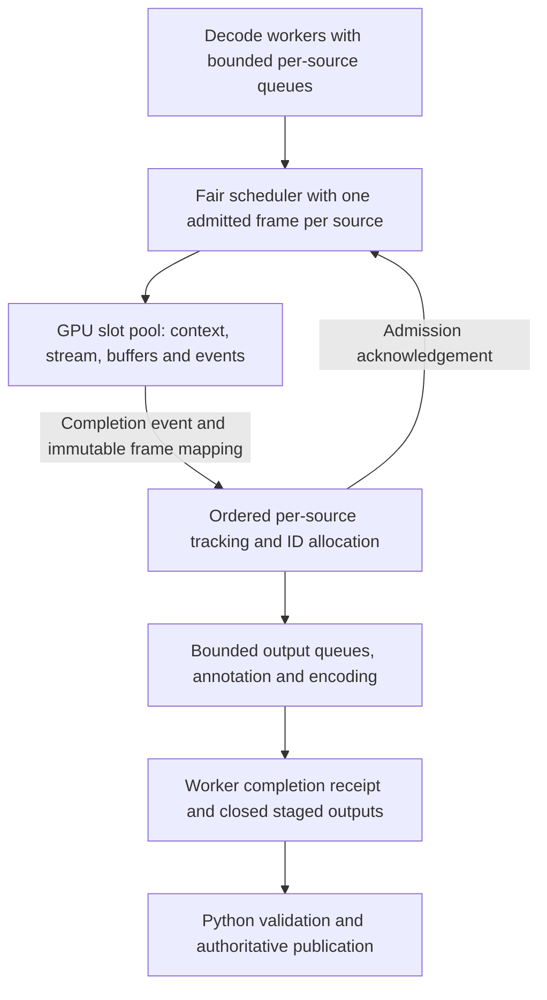

# MotionMan Native NVIDIA Engine

## Architecture and Implementation Plan

**Prepared for:** Abdullahi Mohamed  
**Design revision:** 1.0  
**Date:** November 4, 2026  
**Repository:** [abdullahimohamed101/motion-man](https://github.com/abdullahimohamed101/motion-man)  
**Reviewed commit:** `4e1299daebfebfce9979494637c45e28f8fbe453`

**Purpose:** Turn the existing MotionMan application into a genuine C++ / CUDA / TensorRT / OpenCV system while keeping the Mac-first workflow and reusable product features.

**Design position:** Selective runtime rewrite. One NVIDIA workstation. Whole-run remote execution. Bounded concurrency. Verified artifacts. Measured claims.

**Evidence boundary:** This is an implementation plan, not a certification that the existing repository already implements the native stack or has achieved the historical performance figures. Repository and workstation changes require a separate implementation request.

This Markdown edition contains the full design from the Word/PDF version, with self-contained Mermaid diagrams for GitHub and compatible editors.

## Reading guide

Read Sections 1–4 for the decision and scope, Sections 5–13 for implementation contracts, and Sections 14–18 for validation and delivery. Start with Section 16 for the build order and Section 18 for the first ten actions.

Implement one gated vertical slice at a time. Proposed paths, interfaces, and commands describe work to create; they are not commands already supported by the reviewed checkout.

## Contents

- [1 Executive decision](#1-executive-decision)
- [2 Existing system and reuse assessment](#2-existing-system-and-reuse-assessment)
- [3 Requirements and scope boundaries](#3-requirements-and-scope-boundaries)
- [4 Component boundaries and repository structure](#4-component-boundaries-and-repository-structure)
- [5 Model and engine contract](#5-model-and-engine-contract)
- [6 Native runtime architecture](#6-native-runtime-architecture)
- [7 Concurrency and memory ownership](#7-concurrency-and-memory-ownership)
- [8 Tracking and output semantics](#8-tracking-and-output-semantics)
- [9 GPU development environment](#9-gpu-development-environment)
- [10 Artifact and schema contracts](#10-artifact-and-schema-contracts)
- [11 Remote execution and job lifecycle](#11-remote-execution-and-job-lifecycle)
- [12 Python integration and migration strategy](#12-python-integration-and-migration-strategy)
- [13 Security reliability and recovery](#13-security-reliability-and-recovery)
- [14 Test and validation strategy](#14-test-and-validation-strategy)
- [15 Benchmark and resume evidence plan](#15-benchmark-and-resume-evidence-plan)
- [16 Phased implementation roadmap](#16-phased-implementation-roadmap)
- [17 Risks and decision gates](#17-risks-and-decision-gates)
- [18 Release and engineering handoff](#18-release-and-engineering-handoff)
- [19 References and evidence boundary](#19-references-and-evidence-boundary)

## Terms

| Term | Meaning |
| --- | --- |
| Session | One admitted native processing workload containing independent source streams |
| Child run | One source's compatible records, video, report, and publication identity |
| Attempt | One concrete execution; a deliberate retry receives a new attempt ID |
| GPU slot | Owned context, CUDA stream, buffers, events, and immutable batch mapping |
| Reference backend | Existing Python implementation or frozen model runtime used for a specified comparison |

---

## 1 Executive decision

Evolve MotionMan in the existing repository. Preserve its useful product surface and evidence infrastructure, but replace the frame-processing runtime with a separately executable C++ engine on the NVIDIA workstation. The Mac remains the primary development and interaction machine. CUDA compilation, TensorRT engine building, GPU execution, profiling, and GPU-specific validation run on the PC.

This is a selective rewrite of the execution layer, not a complete product rewrite and not a remote detector bolted onto the current synchronous Python loop. The native process owns video decoding, bounded scheduling, preprocessing, TensorRT inference, ordered tracking, rendering, and result writing. Python remains appropriate for the UI, job control, model export, inspection, analytics, benchmark analysis, and artifact finalization outside the per-frame hot path.

The implementation must establish three different facts independently: the requested technologies genuinely execute; the application remains correct and usable; and any performance or tracking-quality claims are supported by reproducible measurements. A design document can specify those requirements. It cannot certify that the current repository already meets them or guarantee that an unknown GPU will reach every historical target.

### 1.1 Recommended architecture in one view



*Figure 1. Mac and workstation responsibilities. The network carries jobs and artifacts, not a per-frame GPU call.*

The network is a job and artifact boundary, not a per-frame inference boundary. Upload a source once, process it next to the NVIDIA GPU, and bring verified results back. During development, a remote editor session can expose the PC checkout directly while the keyboard, screen, and editor client remain on the Mac. During normal use, the Mac UI submits a versioned job request and displays progress without becoming part of GPU scheduling.

### 1.2 Decisions to adopt

| Decision | Rationale | Consequence |
| --- | --- | --- |
| Keep one repository and two explicit execution backends | Preserve the application and a working reference path | Native code is additive; old results remain readable |
| Run the full native pipeline on the PC | Avoid frame serialization and network jitter in the hot path | Results, not live tensors, cross the remote boundary |
| Build a serial batch-one baseline first | Isolate model, coordinate, tracker, and artifact errors | Concurrency is an optimization after correctness |
| Use one tracker per source and a small GPU slot pool | Detector weights can be shared; mutable identities cannot | Twenty-five sources do not require twenty-five models |
| Keep one child run per stream | Existing records assume one source and one frame sequence | A new session groups compatible child artifacts |
| Publish evidence even when a numerical target is missed | Avoid tuning toward unsupported resume numbers | Claims become met, unmet, or inconclusive |

### 1.3 Status and limits of this document

This is a proposed engineering design, not an implementation report. The repository snapshot reviewed is commit `4e1299daebfebfce9979494637c45e28f8fbe453`, on the main branch as checked for this plan. Source and tests were inspected read-only. No code, tests, GPU benchmark, installation, branch, pull request, or configuration change was executed on the user's machines as part of preparing this document.

Sections describing existing modules are observations of that snapshot. Proposed directories, interfaces, commands, defaults, and acceptance thresholds are implementation requirements, not claims that those items already exist. All effort estimates assume a working supported NVIDIA workstation and will be revised after the first hardware and model-export gates.

## 2 Existing system and reuse assessment

### 2.1 What exists today

The current processing path is a Python/OpenCV loop with Ultralytics YOLO inference and persistent ByteTrack state. It reads a frame, invokes tracking, constructs a record, updates trails and annotations, writes the video and JSONL output, and reports progress. Those operations are sequential in the inspected path. The CUDA option selects the PyTorch device; it is not a native C++/CUDA/TensorRT implementation. The reviewed tree has Python application and test modules but no C++ source, CUDA translation units, headers, or CMake build. [R1] [R2]

The product already provides meaningful infrastructure: managed sources, run specifications, staging and atomic publication, verified run inspection, comparison concepts, a Streamlit UI, and saved-record analytics including zones and events. These are assets worth preserving. They should not be discarded simply because the performance-sensitive runtime changes languages. [R3] [R4]

The current record contract assumes a single constant-frame-rate source, contiguous frame indices, and every frame processed. It supports null track IDs and valid empty-object frames. These semantics provide a valuable compatibility target. They do not yet describe frame dropping, variable-frame-rate timestamps, cross-camera identities, or live-source reconnection. [R3]

### 2.2 Reuse map

| Area | Disposition | Required work |
| --- | --- | --- |
| UI layout, inspection, zones, analytics | Preserve substantially | Add backend/session selection and report adapters |
| Record readers and fixtures | Preserve and strengthen | Prove native writer compatibility; tighten validation |
| Hashing, managed inputs, staging, publication | Reuse design and tested code | Resolve backend metadata; introduce session-scoped admission |
| Python pipeline and tracker | Retain as legacy/reference | Keep explicit labels; do not pretend this is native execution |
| Per-frame execution | Rebuild in C++ | Decode, scheduler, TensorRT, CUDA, tracking, render, output |
| Timing and benchmark dispatch | Refactor | Separate concurrent service times, wall time, and execution-host metadata |
| Remote execution | Add | Durable job identity, reconnect, cancellation, verified import |
| Debug bundles | Keep for diagnostics | Introduce a different byte-preserving transport for canonical results |

### 2.3 What must not be copied blindly

The existing RunSpec resolution assumes Ultralytics configuration and FP32. The UI runner calls the Python pipeline directly and treats returned paths as local. The metrics model assumes stages do not overlap. The debug exporter sanitizes and reserializes JSON. Each is reasonable within its current purpose, but each becomes a correctness bug if reused unchanged as native execution metadata, asynchronous timing, or canonical remote transport. [R3] [R4] [R5]

The repository's current invariants and release scope also need an explicit migration ADR when implementation is authorized. In particular, the old detector-plus-tracker ownership rule should evolve into shareable immutable detector resources plus isolated mutable tracker state. That is a documented invariant change, not a reason to weaken stream isolation. This document itself does not change repository policy. [R1]

## 3 Requirements and scope boundaries

### 3.1 Functional requirements

- Execute a real C++ binary using OpenCV and an NVIDIA GPU through CUDA and TensorRT. Load a frozen RT-DETR model rather than quietly retaining YOLO behind a renamed backend.
- Process local constant-frame-rate video files fully and in order. Preserve source coordinates, empty detections, null identities where appropriate, deterministic record ordering, and failure visibility.
- Support multiple independent sources in one session, scaling through 1, 2, 4, 8, 16, and 25-source workloads only after earlier gates pass.
- Preserve current inspection, replay, zone, and analytics behavior through compatible child-run records and explicit report adapters.
- Develop portable logic and UI locally on the Mac, with real GPU builds and tests on the PC. Allow a disconnected UI to reconnect to an existing job.
- Produce a verifiable build, run, and benchmark record that identifies the executed code, model, engine, hardware, settings, and measurement boundaries.

### 3.2 Nonfunctional requirements

Correctness precedes speed. Memory must be bounded by configuration rather than video duration. Queues must apply explicit backpressure. A failed or incomplete source cannot produce a successful benchmark. Existing source files and published results must never be overwritten. A GPU backend must fail visibly if its required device or runtime is unavailable; silent CPU fallback is prohibited for native acceptance and performance runs.

Reproducibility requires pinned inputs and explicit variation, not an assertion that every run is bit-identical. Usability requires clear distinctions between unavailable, queued, running, disconnected, cancelled, failed, and successfully imported results. Observability must remain bounded and must describe the execution host rather than the Mac controlling it.

### 3.3 Resume alignment as an evidence contract

| Target or claim | What the architecture must implement | What still needs measurement |
| --- | --- | --- |
| C++, CUDA, TensorRT, OpenCV, NVIDIA GPU | Native processing binary with genuine device execution | Build and runtime evidence; no fallback |
| Asynchronous multithreaded pipeline | Bounded CPU stages plus independently owned CUDA slots | Timeline proving useful overlap and ordered outputs |
| RT-DETR and FP16 | Frozen export, inspected TensorRT engine, documented precision policy | Model parity and quality budgets |
| 40+ FPS across 25+ streams | Concurrent, independently identified sources | Aggregate versus per-stream scope, workload, resolution, hardware |
| 45% lower latency and 1.8x throughput | Controlled baseline and candidate configurations | Same-boundary repeated measurements |
| 35% fewer identity switches under occlusion | Explicit tracking changes and labeled sequential evaluation | Absolute IDSW counts and quality guardrails |

These are targets to evaluate, not results carried forward automatically from earlier resume wording. Confirm the exact submitted bullet text before freezing the experiment specification. In particular, never let “40 FPS across 25 streams” imply 40 FPS for each stream unless that was actually measured. No percentage is an unconditional release guarantee.

### 3.4 Deliberately excluded from the first release

- Multi-GPU scheduling, distributed inference, Kubernetes, Kafka, Redis, and cloud autoscaling.
- Public internet job endpoints, multi-tenant access control, billing, and a general remote-compute platform.
- Model training, TensorRT custom plugins unless the selected model demonstrably requires one, and hand-written kernels without a measured purpose.
- RTSP cameras, variable-frame-rate support, frame dropping, cross-camera re-identification, and tracker-state recovery after a crash.
- Automatic GPU driver installation, system power changes, or network exposure without the user's separate approval.

Hardware video decoding, GPU rendering/encoding, CUDA Graphs, and more aggressive batching remain optional measured optimizations. None is a prerequisite to truthfully using C++, CUDA, TensorRT, and OpenCV. Do not claim NVDEC simply because OpenCV reads a video.

## 4 Component boundaries and repository structure

### 4.1 Execution planes

The control plane is Python: it validates requests, resolves immutable configuration, admits one GPU session, launches and observes the native process, finalizes staged artifacts, and serves job status. The data plane is C++: it processes frames without a Python callback per frame. The analysis plane consumes saved, verified records and is independent of the inference runtime.

The native executable must also run from a PC terminal without the Mac UI. This gives a minimal reproducible benchmark path and keeps remote integration from blocking initial GPU correctness. For early milestones, SSH plus a supervised command is enough; the durable job adapter comes after the serial and bounded asynchronous engine work.



*Figure 2. Native pipeline and finalization boundary. The initial engine uses one slot and batch one; additional slots and batching are separate acceptance gates. Original frame storage remains owned through rendering and encoding.*

### 4.2 Proposed module layout

The following names are proposed, not present in the inspected repository. Preserve the current Python modules until parity and migration gates pass.

| Proposed location | Responsibility | Dependency boundary |
| --- | --- | --- |
| `native/include/motionman` | Frame keys, detections, configuration, interfaces | Portable C++; no mandatory CUDA headers |
| `native/src/core` | Bounded queues, scheduling, lifecycle, tracking | CPU-testable library |
| `native/src/io` | OpenCV decode, annotation, encoding, records | No remote transport logic |
| `native/src/gpu` | CUDA buffers/events, preprocessing, TensorRT executor | NVIDIA-only build target |
| `native/src/cli` | Worker executable and diagnostics | Structured protocol; no UI dependency |
| `native/tests` | Unit, contract, failure, GPU integration tests | GPU tests explicitly tagged |
| `motionman/backends` | Legacy, native-local, native-remote dispatch | Whole-run interface, not per-frame calls |
| `motionman/remote` | Request identity, status, transfer, import | SSH and canonical artifact contracts |
| `tools/model_export` | Pinned export and golden-tensor generation | Python build-time workflow only |
| `tools/evaluation` | Detection/identity evaluation and claim reports | Reads immutable evidence |
| `configs/native` | Versioned model, tracker, scheduler profiles | Resolved settings saved per attempt |

### 4.3 Engineering decision records

Record the following ADRs as implementation begins: whole-run backend boundary; Linux/WSL target and dependency matrix; RT-DETR export/precision contract; tracker ownership and class semantics; bounded scheduling/slot lifetime; child-run schema compatibility; durable remote job protocol; concurrent timing and evidence policy. Each ADR should state the choice, alternatives rejected, impact on existing invariants, and conditions that would justify revisiting it.

The first alternative to reject is a frame-by-frame RPC wrapper around the current `Tracker.update`: it leaves the pipeline architecture unchanged while adding network cost. The second is a wholesale rewrite of the UI and analytics: it adds risk without advancing the GPU claim. A Python TensorRT proof of concept can de-risk export, but it is a temporary feasibility tool, not the finished native engine.

### 4.4 Ownership and interface rules

Pass typed values and move-only ownership handles across native stages. Do not pass borrowed frame pointers across asynchronous boundaries without an owner. Keep stream identity, source frame index, source timestamp, dimensions, and transform metadata attached to the work item until output publication. Separate recoverable request errors from fatal worker/context failures. The native worker writes structured status records; human-readable logs go to a separate stream so they cannot corrupt the protocol.

Configuration is resolved once before launch. A running worker cannot silently change model, resolution, precision, batching, thresholds, or output policy to make a workload fit. Admission can reject an infeasible request with a suggested smaller configuration; an intentional retry receives a new attempt identity and an explicit configuration diff.
## 5 Model and engine contract

### 5.1 Establish one reproducible detector identity

The audited application currently delegates detection and tracking to Ultralytics. The following RT-DETR deployment contract is proposed work, not an existing capability. Select one original RT-DETR implementation, checkpoint, configuration, and upstream revision. Do not mix an original RT-DETR checkpoint with an unrelated exporter merely because both packages expose the same model name. An R18-class checkpoint is a reasonable initial candidate; the final variant remains a hardware-gate decision, not a promised performance result.

Create a version-controlled deployment profile under `configs/native/` and a generated `manifest.json` in the selected model's cache directory before implementing TensorRT inference. The profile expresses intended settings; generated provenance records actual artifacts. Record the checkpoint SHA-256, upstream commit, architecture/configuration, class vocabulary, exporter revision, ONNX opset, input/output names and types, precision policy, preprocessing revision, and licensing/provenance. Model export and engine construction are offline preparation steps. Neither should occur implicitly inside a timed tracking run.

The original upstream exporter wraps the detector together with its deployed postprocessor. It exposes `images` and `orig_target_sizes`, producing `labels`, `boxes`, and `scores`; its original dynamic batch annotation applies to both inputs. The deployed postprocessor already converts boxes, scales coordinates, and selects scores. This contract must be verified against the pinned export rather than reconstructed from YOLO assumptions. [S6]

### 5.2 Specify preprocessing and output interpretation

Begin with fixed spatial dimensions of 640 by 640 and batch size one. The selected original validation configuration uses direct resizing, not YOLO letterboxing. Freeze RGB/BGR conversion, interpolation and antialiasing, scalar conversion, normalization, channel layout, and coordinate rounding in a machine-readable preprocessing contract. An OpenCV resize and a Python transform are not automatically numerically equivalent.

| Boundary | Proposed initial contract | Required check |
| --- | --- | --- |
| Images | RGB, NCHW, fixed spatial dimensions; explicit input dtype | Golden tensor comparison |
| Original sizes | One width-height pair per batch entry | Portrait and landscape fixtures |
| Boxes | Floating xyxy in source-image pixels | Bounds and geometry validation |
| Labels and scores | Pinned class-index mapping and confidence convention | Vocabulary and finite-value checks |

Inspect actual exported integer types and TensorRT tensor locations. Do not assume labels are int32, or that an input containing dimensions is necessarily a TensorRT shape tensor. The original implementation stores original sizes in width-height order. Its deployment return precedes optional sparse COCO category remapping, so the application must explicitly own the label vocabulary. It does not require adding YOLO-style NMS to its existing postprocessing. [S6]

Keep tracker admission thresholds separate from display thresholds. Low-confidence candidates may be useful for ByteTrack association even when they should not appear as visible detections. Never run sigmoid, top-k, scaling, or suppression twice because an export already contains those operations.

### 5.3 Engine construction and precision policy

Create a build command that consumes the model manifest and produces an engine, an engine manifest, and a complete build log. The engine cache identity includes checkpoint and ONNX hashes, exporter/preprocessing revisions, target GPU, TensorRT/CUDA versions, optimization profiles, precision policy, plugins, and build settings. A mismatch requires an explicit rebuild, not a warning followed by optimistic loading.

Do not prescribe the newest toolkit before discovering the PC hardware. Choose a supported intersection of GPU compute capability, driver, CUDA, TensorRT, compiler, and operating system. TensorRT plans are not generally portable between operating systems or GPU architectures; compatibility modes must be deliberately selected and tested. Build and validate on the intended NVIDIA execution environment. [S1]

If TensorRT 11 is selected, follow its strongly typed precision workflow. Encode appropriate types and casts in the graph or use supported precision-conversion tooling. Do not copy obsolete blanket `kFP16` or `--fp16` instructions from older tutorials. Preserve sensitive computations in FP32 when required and describe the result accurately as mixed-precision inference. The pinned TensorRT migration guide governs the final implementation. [S5]

Record and hold the FP32 reference's TF32 policy constant using the mechanism supported by the pinned runtime. FP32 input and output tensors alone do not fully specify internal arithmetic. Include this policy in the model/engine manifest and benchmark comparison factors; a changed TF32 policy is a changed experimental configuration.

### 5.4 Model acceptance gates

Validate in this order: pinned Python reference, ONNX reference, TensorRT FP32, then mixed-precision TensorRT. Use identical images and transform contracts. Compare detections by class and geometric matching, not their position in a reordered top-k array.

The following are proposed project policies, not vendor guarantees or measured MotionMan results. Investigate failures before changing a tolerance.

| Comparison | Proposed initial gate | Interpretation |
| --- | --- | --- |
| Channel/layout conversion without resizing | Maximum normalized error 1e-6 for FP32; 5e-4 for FP16 | Detect conversion mistakes |
| Matching resize implementations | MAE at most 1/255; p99 error at most 3/255 | Review synthetic-pattern outliers |
| TensorRT FP32 detections | At least 99% same-class matches at IoU 0.99; score error at most 0.005 | Frozen confidence policy |
| Mixed-precision detections | At least 99% same-class matches at IoU 0.95; score error at most 0.02 | Follow with labeled evaluation |

Require zero nonfinite accepted outputs. Report near-threshold and tiny-object exceptions rather than discarding them silently. Use a proposed quality budget of at most 0.5 absolute percentage points of detection mAP loss and 1.0 point of HOTA/IDF1 loss relative to the frozen FP32 reference. These gates require a declared labeled corpus; they do not establish the resume's improvement claims.

## 6 Native runtime architecture

### 6.1 One process, one explicit execution boundary

Introduce a headless `motionman-native` executable. Python remains the application coordinator and artifact consumer. The executable owns the performance-critical video path; Python must not shuttle individual image tensors across the process boundary. Initially use a command/configuration file plus structured progress events and the existing artifact directory. Avoid introducing a network service, distributed queue, or per-frame RPC for a single workstation.

The native process receives a session configuration, validates paths and manifests, deserializes the trusted engine, performs warm-up, and reports readiness. The session supervisor owns the exclusive GPU admission lease and retains it until its worker exits. A direct standalone launch uses a thin launcher that takes the same lease; never independently acquire the same non-reentrant lock in both parent and child. The lease prevents MotionMan sessions from contaminating each other's benchmark. It cannot prevent unrelated desktop applications from using the GPU; competing activity remains benchmark metadata.

The proposed `motionman-native run` entry point is that standalone launcher, not a bypass around admission. Internal worker mode requires an inherited lease descriptor. On the Linux/WSL target, explicitly pass the locked file descriptor to the worker and keep it open for the worker's full lifetime; never unlock it while work remains active. This keeps exclusivity if the supervisor dies while the worker survives. Restart reconciliation must discover the live attempt before admitting another session. Test supervisor termination separately from worker termination.

Native completion means the worker has closed its staged outputs and supplied a completion receipt. The Python finalizer alone commits authoritative job success after independent validation and publication. A standalone native run therefore still requires the finalization step before its results enter the verified application run shelf.

### 6.2 Components and responsibilities

| Component | Responsibility | Ownership boundary |
| --- | --- | --- |
| Worker coordinator | Configuration, startup, cancellation, worker completion/error status | Native process |
| Source reader | Decode frames and preserve source timing | One source state |
| Admission scheduler | Fair selection and bounded batching | All active sources |
| GPU executor | Preprocessing and TensorRT submission | Bounded execution slots |
| Tracker bank | Ordered association and identity lifecycle | Separate stream states |
| Artifact writer | Records, metrics, video, completion metadata | Ordered output queues |

Use C++20 where the selected compiler/toolkit combination supports the project cleanly; otherwise choose a documented compatible C++ standard. CMake must expose CPU-only tests separately from CUDA targets. Model adapters, tracking logic, scheduling, and artifact serialization should not require a GPU merely to compile their unit tests.

### 6.3 End-to-end frame flow

A reader produces an owned decoded frame with stream ID, source sequence number, source timestamp, decode timestamp, geometry, and pixel stride. Admission chooses a ready source fairly and obtains an available GPU slot. GPU preprocessing writes the exact engine input layout, inference executes, and compact detection results return to pinned host output buffers. Completion dispatches results to the correct tracker state. Tracking produces an immutable output record and releases the source's admission token.

Initially permit at most one admitted frame per source until tracking acknowledges completion. This prevents later frames from overtaking earlier tracking updates without a reorder buffer. Several sources can still overlap across two GPU slots. Rendering, encoding, and disk writing consume bounded output queues and must not retain mutable tracker objects.

Start with CPU OpenCV decoding. Add hardware decode only when profiling establishes a decoding bottleneck and the actual GPU/backend supports the required codec and concurrency. The presence of OpenCV in the stack does not establish NVDEC use.

### 6.4 Modes, backpressure, and failure boundaries

Offline correctness mode processes every decodable source frame. Full queues block admission or readers; they do not silently discard frames. Live freshness mode is a later capability with an explicit drop policy, source-sequence accounting, and separate tracking-gap semantics. Benchmark reports identify the mode so dropped work cannot inflate useful-frame throughput.

Bound every queue by frame count and memory budget. Configuration validation rejects an impossible pool size before opening all sources. A stalled reader must not block ready sources. A slow writer propagates bounded backpressure rather than consuming unlimited memory. Optional preview generation may be disabled independently of required record production.

Distinguish input failures from session failures. A corrupt source may terminate that stream under the configured policy; an invalid engine, fatal CUDA failure, output-integrity failure, or exhausted mandatory resource fails the session. Record partial progress honestly. A cancellation is not a successful run, and successful process exit alone does not substitute for validated final artifacts.

## 7 Concurrency and memory ownership

### 7.1 Begin with correctness, then introduce overlap

Milestone one uses one context, one non-default CUDA stream, batch one, and fixed input shape. Milestone two introduces two independent GPU slots. Optional batching is a separate milestone with batch sizes one through four and fixed spatial dimensions. Do not combine all three changes into the first native implementation.

Each slot owns an execution context, CUDA stream, activation allocation, device inputs/outputs, pinned staging buffers, events, and a batch-to-frame map. The engine may be shared, but the mutable context is not submitted concurrently. Context memory remains private while execution is active. TensorRT's enqueue return means submission succeeded, not that results are ready. [S3]

### 7.2 Slot lifetime protocol

Use the following state machine as an implementation invariant:

```text
FREE -> FILLING -> SUBMITTED -> GPU_COMPLETE -> CPU_CONSUMING -> FREE
```

Assign a generation number whenever a slot is acquired. Every completion message carries slot ID and generation; reject stale completions. Record a final event after the output transfer on the slot stream. CPU consumers may read output only after that event establishes completion. Recycle the slot only after CPU consumption also finishes.

This conservative lifetime intentionally retains some resources longer than strictly necessary. Later optimization may release pinned input after its copy completes or device input after TensorRT's input-consumed event, but only with independently tested ownership. Never release output memory merely because input consumption completed. [S3]

Decoded-frame storage must remain owned until every consumer is finished. In an annotated-output run, the original image or an explicitly owned render copy remains alive through annotation and encoder consumption, not merely preprocessing. Upload staging may be recycled after its transfer completes, independently of the retained render frame. Account for non-contiguous OpenCV matrices, row pitch, ROI offsets, and temporary views. A borrowed pointer is not a lifetime guarantee. Prefer move-only buffer handles and RAII wrappers over shared mutable raw allocations.

### 7.3 Streams, allocation, and error handling

Enqueue dependent preprocessing, inference, and transfers on the same slot stream initially. Cross-stream work requires explicit event dependencies. Use bounded pinned buffers where asynchronous host-device transfers are intended, and measure whether the hardware actually overlaps copies with computation. CUDA events measure device execution intervals; CPU enqueue duration is not inference latency. [S8]

Allocate steady-state device and host pools at startup. Avoid per-frame allocation and global device synchronization. Check immediate CUDA return codes, kernel launch errors, TensorRT enqueue results, and eventual completion errors. Diagnostic profiling that changes synchronization behavior must not be silently enabled in a published benchmark.

On fatal GPU failure, stop new submissions, preserve the error and partial artifact status, and restart through a clean worker process. Do not claim that catching an exception restores a failed CUDA context. Shutdown stops admission, wakes blocked queues, drains or marks cancelled work, waits for in-flight operations, joins CPU consumers, and only then destroys buffers, contexts, streams, and the engine.

### 7.4 Optional dynamic batching

For dynamic batch sizes one through four, define minimum, optimum, and maximum shapes for every batch-dependent input. Set the profile before input shapes and bind correctly sized storage before enqueue. Profile selection and execution must be ordered on the same stream or explicitly synchronized. Warm each supported shape before measuring it. [S4]

Use a separate compatible optimization profile for each concurrently active context unless the exact pinned release explicitly supports and passes tests for profile sharing. Do not alter an in-flight context's profile, shape, or addresses. TensorRT's current context contract documents these ownership and ordering constraints. [S3]

Batch entry identity is immutable from admission through tracking. Never count padding or duplicated frames as useful processing. A maximum batch-wait deadline prevents low-traffic sources from stalling ready work. Twenty-five source streams are not twenty-five engine copies: source count, execution-slot count, and batch size are independent controls.

Acceptance requires identifiable pattern frames across adjacent slots, all batch sizes, cancellation during each state, repeated startup/shutdown, bounded memory under a slow writer, and a timeline demonstrating the intended overlap without changing output ordering.

### 7.5 Resource budgets and admission defaults

Start with a decode pool of two to four workers, a decoded queue capacity of two frames per source, one admitted inference frame per source, one GPU slot, and batch one. These are proposed conservative defaults, not a tuned optimum. A source's capture object has one owner at a time; cooperative decode work must not concurrently access the same OpenCV capture. Schedule ready sources round-robin, skipping a source without a frame instead of blocking all others. Bound output queue depth independently so a slow encoder cannot retain all source frames.

Budget source frames, pinned transfer buffers, device inputs, device outputs, engine weights, activation allocations, codec buffers, track histories, and telemetry separately. A 1920 by 1080 BGR frame contains 6,220,800 pixel bytes, approximately 5.93 MiB. Two queued frames for each of 25 sources already use approximately 296.6 MiB before active frames, decoder buffers, and output queues. A 640 by 640 three-channel FP16 input is approximately 2.34 MiB; batch four in two slots is approximately 18.75 MiB of input tensors alone, not the engine's total VRAM cost.

Discover actual engine/context requirements and available GPU memory at startup. Reserve a configurable safety margin and reject the request if its bounded allocations cannot fit. Never derive a claim of 25-stream capacity from input tensor size alone. Track high-water marks and pool exhaustion; retained telemetry and removed-track history must also have caps. If batching is enabled, begin with a declared maximum wait such as 5 ms, then tune against measured throughput and latency rather than silently extending the wait.

## 8 Tracking and output semantics

### 8.1 Own the tracker adaptation

Treat the original ByteTrack C++ demonstration as reference material, not a drop-in replacement. Its observed implementation ignores the input class label, lacks a class field in `STrack`, hardcodes thresholds, increments age per update, and uses a shared unsynchronized static ID counter. Those choices require adaptation for MotionMan's multistream, multiclass application. [S7]

Introduce a tracker bank keyed by stream ID. Each stream owns association state, motion state, lost-track lifecycle, configuration, and a local ID allocator. Either apply class-aware matching gates or maintain class partitions sharing the stream allocator. Do not allow a person detection to update a vehicle track through geometry alone.

The external identity is `(session_id, stream_id, local_track_id)`. Preserve existing run-local expectations by grouping per-stream runs under a session instead of pretending IDs are globally meaningful. Cross-camera re-identification is outside this design.

### 8.2 Separate algorithm parity from model changes

Create detection-replay fixtures that bypass inference. Feed identical detections and timestamps into the reference tracker and native adapter. Test entry, disappearance, reappearance, overlap, class conflict, empty frames, low-confidence recovery, and deterministic matching ties. Compare associations after canonical ID renaming; counter values alone are not tracking quality.

Document intended differences from Ultralytics, which is not guaranteed to match the original C++ implementation. Do not silently tune thresholds until the output looks similar. Expose association, new-track, and retention settings in the run manifest. Keep removed-track storage bounded and validate long-running identity behavior.

For offline no-drop execution, frame-based aging has a clear interpretation. Live dropping requires explicit source-time or source-sequence gap handling. Updating a fixed-step filter once after skipping many source frames is not equivalent to continuous tracking. Implement and test that extension separately, including long gaps and reconnect boundaries.

### 8.3 Preserve artifact meaning

Continue using source-image coordinates and stable stream-local frame indices. Keep source timestamps separate from processing timestamps. Every successfully processed offline source frame produces a record, including frames with no detections. Native output must pass the existing readers and validators before the UI switches its default backend.

Do not overload existing record fields to disguise new semantics. If future skipped, predicted-only, or dropped observations require representation beyond the current schema, introduce a versioned extension and compatibility tests. Keep raw detections distinguishable from tracked objects so association behavior remains auditable.

The Python application should display backend, model, precision, execution environment, and evidence status. A TensorRT run should not appear indistinguishable from the Python reference when comparing performance. Finalization follows the existing manifest/hash contract; incomplete output remains visibly incomplete.

Acceptance includes old artifact fixtures remaining readable, native fixtures passing schema validation, independent identities for identical videos in different streams, deterministic cancellation status, and source-coordinate overlays on non-square inputs. The resume's identity-switch reduction additionally requires labeled evaluation with a declared baseline, not visual inspection alone.

## 9 GPU development environment

### 9.1 Mac-first workflow, PC-local computation

The Mac remains the primary editor and browser. Use an authenticated SSH development connection to the NVIDIA PC's Linux environment. Source files may be edited remotely through the editor; CMake, the CUDA compiler, TensorRT engine construction, GPU tests, and benchmarks execute on the PC. Store benchmark videos and engines on that machine so network transfer is not part of each frame's hot path.

The intended product arrangement keeps the Python UI on the Mac. Before the remote job adapter exists, an optional development shortcut runs that UI on the PC and forwards its local port over SSH to the Mac browser. Clearly distinguish this temporary shortcut from the final Mac-local UI and verified-import workflow. Do not expose an unauthenticated inference server to the public internet. Process supervision must define cancellation and reconnect behavior independently of the remote editor connection.

### 9.2 Hardware discovery is a blocking implementation gate

The NVIDIA GPU model, VRAM, operating system, and driver remain unknown. Collect them before selecting package versions or promising throughput. Record compute capability, driver, installed toolkit/compiler, TensorRT version, compiler, CMake, OpenCV backend, available storage, and power/thermal conditions. The CUDA version printed by `nvidia-smi` does not establish that `nvcc` is installed.

Choose one compatible stack and freeze its package/build manifest. Avoid combining examples from incompatible TensorRT generations. An unsupported GPU cannot be repaired by changing C++ application logic; select a compatible supported release or another execution host after the gate fails. [S1]

### 9.3 Linux and WSL2 policy

Native Linux is the simplest reference execution environment. If the PC uses Windows, WSL2 is a candidate after verifying the exact GPU, Windows driver, and tooling combination. NVIDIA's WSL guidance uses the Windows NVIDIA driver; do not install a Linux GPU driver that overwrites the WSL mapping. [S2]

Design around WSL's documented managed-memory, pinned-memory, telemetry, and graphics-interoperability limitations. Keep pools bounded, prefer explicit transfers, and keep processing headless. Unsupported utilization metrics must be null or marked unavailable, never invented as zero. Profile WSL as its own environment and record it in benchmark evidence. Current version-specific instructions govern package installation. [S2]

G0 environment readiness requires the hardware inventory, a supported installed stack, and a successful real CUDA smoke test. G1 adds a small TensorRT inference test and model parity. The G2 end-to-end platform gate adds the native build, CPU tests, GPU fixtures, and one complete artifact-producing run controlled from the Mac. Only then begin optimization or capacity scaling. No installation or architectural choice alone substantiates the historical FPS, latency, or identity-switch claims.

### 9.4 Daily developer loop and proposed commands

Use `nvidia-smi`, `nvcc --version`, and `cmake --version` on the execution host to collect installed capabilities; missing commands are explicit setup findings. Do not execute workstation diagnostics in the Mac shell and mistake those results for PC inventory. On Windows, establish whether the command is running in PowerShell or the intended WSL distribution before recording its environment.

The commands below are proposed interfaces to create during implementation, not commands supported by the current repository. The CPU preset must not discover or require CUDA. The NVIDIA preset must fail if the requested dependencies are missing.

```text
## Mac portable-core loop after the presets are implemented
cmake --preset mac-cpu
cmake --build --preset mac-cpu
ctest --preset mac-cpu

## NVIDIA PC loop inside the chosen Linux environment
cmake --preset linux-cuda-release
cmake --build --preset linux-cuda-release
ctest --preset linux-cuda-release -L gpu
./build/linux-cuda-release/motionman-native run --config resolved_session.json
```

Choose either a PC remote checkout edited from the Mac or two explicit Git checkouts with reviewed commits as the synchronization unit. Do not combine automatic bidirectional folder sync with builds and generated engines. Record the executed commit and dirty-tree digest when an intentional uncommitted experiment is run; a Mac edit is not evidence that the remote binary was rebuilt. Keep footage, build directories, and engine caches out of ordinary source commits. On the Mac, use cached detections and fake execution backends for UI/contract tests; only a real PC run clears GPU gates.
## 10 Artifact and schema contracts

### 10.1 Preserve evidence, not implementation details

The migration boundary is a completed run, not an individual frame. The native process owns decode, CUDA preprocessing, TensorRT inference, association, rendering, encoding, and streamed result output. Python retains orchestration, verification, browsing, and analysis. Existing saved runs remain readable; native execution must not silently rewrite historical measurements or label a Python result as native. [R1][R2]

The first native compatibility target is recorded constant-frame-rate video, every frame processed, without dropping or sampling. Each stream produces a separate child run. Its `tracks.jsonl` keeps record schema `1.0`, including `run_id`, `source_frame_index`, `source_t_us`, `sample_index`, `frame_status`, source dimensions, and `objects`. Each object retains observation ID, integer-or-null track ID, class information, confidence, source-pixel `bbox_xyxy`, and null `mask_ref`. Empty frames still produce records; unassigned IDs remain null. [R3]

Frame indexes are contiguous from zero; sample indexes match source indexes. Source time follows the existing CFR rule, rounded integer microseconds from index and FPS, not processing wall time. Golden fixtures must establish cross-language rounding behavior. VFR, dropped frames, and `NOT_INFERRED` require a separately versioned contract and explicit reader changes; they cannot masquerade as v1 every-frame output.

### 10.2 Artifact inventory and versioning

| Artifact | Proposed responsibility | Compatibility rule |
|---|---|---|
| `tracks.jsonl` | Native worker streams observations | Preserve v1 semantics per child run |
| `annotated.mp4` | Native renderer and encoder | Preserve source dimensions, FPS, and expected frame count |
| `runspec.json` | Remote controller resolves executed configuration | Introduce an explicit native RunSpec version and dual readers |
| `report.json`, `timings.jsonl` | Worker measurements plus remote finalizer | Version native timing semantics; preserve legacy interpretation |
| `manifest.json` | Remote finalizer hashes closed artifacts | Retain v1 envelope where unchanged; extend producer metadata |
| `resolved_session.json` | Controller supplies immutable worker input | Distinct from completed session output |
| `session.json` | Remote controller groups concurrent children | New session schema; never replace per-stream records |

Existing `report.json` lacks an explicit schema version. Introduce one before exposing concurrent reports to current views. Keep genuinely comparable fields, but mark unavailable measurements null with a reason. Do not populate the old sequential “unattributed” calculation with invented values: overlapping stage totals can exceed processing wall time. CUDA-event durations, host-stage durations, queue waits, completion latency, and throughput are different measurements. [R4]

The authenticated session/result envelope includes `request_id`, `job_id`, `session_id`, `attempt_id`, resolved session configuration digest, ordered stream definitions, child run IDs, input hashes, child manifest hashes, per-stream outcomes, and session timing. The client verifies this identity against its persisted submission before accepting an import. Track identity is scoped by child run; identical numeric IDs in different streams are unrelated. Aggregate FPS uses completed frames divided by one documented shared execution interval, not a sum of independently measured per-stream FPS. A failed child prevents an all-stream-success session verdict, even when completed sibling runs remain inspectable.

### 10.3 Immutable configuration and provenance

Resolve defaults on the NVIDIA host before execution. Result-determining settings include model family and variant; weights, ONNX, and engine hashes; tensor shapes; optimization profile; batch limits; precision policy; preprocessing and postprocessing rules; class map; tracker implementation and configuration; source range; queue capacities; scheduling policy; and output policy. Record actual GPU, driver, CUDA, TensorRT, compiler, native build, and source revision alongside those settings.

Reuse the existing canonical JSON policy: sorted keys, fixed separators, UTF-8, and no NaN or infinity. The controller computes `config_sha256` over canonical settings bytes and supplies those same immutable bytes to the worker. C++ must not independently regenerate a supposedly identical configuration hash using different floating-point serialization. The report references the executed digest; runtime fallback that changes settings requires an explicit new resolved configuration, not an invisible substitution. [R3]

Transfer original artifact bytes. The existing debug bundle is unsuitable as a canonical import format: it reparses, reserializes, and optionally redacts JSON, and excludes footage by default. Its outer hashes validate that transformed debug package, not equivalence to the original published run. Preserve that useful support feature, but add separate lossless result transfer. [R5]

## 11 Remote execution and job lifecycle

### 11.1 Host responsibilities

The Mac runs the existing interface, edits source, submits configurations, and views imported results. The PC runs the build toolchain, model export or engine preparation when needed, native worker, GPU telemetry, and final validation. Source footage transfers once by content hash; progress and compact status events return during execution. No frame-by-frame RPC, remote NumPy arrays, or network-mounted frame queue belongs in the processing path.

Use authenticated SSH with verified host keys for commands and artifact transfer. A durable execution agent on the PC supervises worker processes independently of SSH sessions and the Mac application. A Linux user service is a suitable deployment; under WSL, explicitly configure equivalent supervision and startup. A daemon thread in Streamlit, an interactive shell, or an SSH connection itself is not the job owner.

### 11.2 Control interface and durable identity

The proposed backend exposes whole-job operations:

```text
submit(request_id, request_digest, input_ids, requested_spec) -> job_id
status(job_id, after_event_sequence) -> snapshot, events
cancel(job_id, expected_attempt_id) -> acknowledged_state
fetch_result(session_id, expected_manifest_hash) -> artifact inventory
```

The agent durably records submission before launch. Generate `request_id` as a fresh unpredictable random identifier; it also serves as the submission nonce checked during import. Reusing that request ID with the same request digest returns the existing job; the same ID with different content is rejected. An intentional rerun receives a new request ID and attempt. This provides idempotent submission and reconciliation, not a claim of distributed exactly-once execution.

Persist `job_id`, `request_id`, request digest, attempt ID, session and child IDs, state, event sequence, timestamps, resolved configuration digest, worker process identity, cancellation request, and terminal artifact references. Use transactional state storage or atomic durable journal updates. Capture stdout and stderr separately from structured progress. A process ID alone is insufficient after restart because IDs can be reused; reconcile a supervised process identity and recorded attempt.

### 11.3 State transitions and interruption

| State | Meaning | Permitted next action |
|---|---|---|
| `ACCEPTED` / `VALIDATING` | Submission persisted; sources and capabilities checked | Reject invalid input or prepare execution |
| `READY` / `RUNNING` | Waiting for admission or executing native work | Report progress or request cancellation |
| `DRAINING` / `VERIFYING` | Closing outputs and validating evidence | Publish success or record failure |
| `SUCCEEDED` / `FAILED` / `CANCELLED` | Authoritative terminal execution state | Inspect, import, or explicitly submit another attempt |

Client connection state is separate. An SSH disconnect changes the Mac's view to `UNKNOWN` or “connection lost”; it does not prove execution failed. Reconnect, query the same job, and resume events after the last sequence. Never automatically submit a duplicate because a response timed out.

Cancellation is a durable request tied to the expected attempt. The worker stops admitting frames, settles or abandons in-flight work according to a bounded shutdown policy, closes outputs, and records an incomplete result. After a configurable grace period, the supervisor may terminate only that attempt's process group. Partial output is diagnostic, not a completed run. Terminal-state updates are conditional: if success was already committed, cancellation returns that terminal state instead of retroactively relabeling it.

Map new job states explicitly to old artifact states. A cancelled incomplete child uses legacy manifest status `INTERRUPTED` and report status `interrupted`; do not add `CANCELLED` to an unchanged v1 envelope. The session/job can record `CANCELLED` independently. Similarly, successful and failed children retain the existing `SUCCEEDED`/`FAILED` manifest and `success`/`error` report mapping, or receive an explicitly versioned replacement contract.

### 11.4 Admission and source staging

One GPU session holds the execution admission lease. Child streams share that session's resources and do not independently acquire the existing exclusive data-root run lock. The controller also serializes conflicting publication operations. On Linux/WSL, the existing `fcntl` mechanism is usable locally, but it neither supports native Windows unchanged nor coordinates machines. Do not share a lock file across Mac and PC and call that distributed scheduling. [R3]

Upload into a bounded temporary location, verify the expected SHA-256, and rename into the managed input store. Reuse an existing source only after checking its digest. Hash-addressed storage avoids trusting uploaded filenames. Keep the PC awake and its supervision service available during work; loss of power triggers restart reconciliation, not automatic success or unbounded relaunch.

## 12 Python integration and migration strategy

### 12.1 Adapt the real seams

The existing `FrameTracker.update(image)` interface is useful for the Python reference backend and fake-tracker tests, but it is the wrong production migration boundary. A TensorRT call behind that interface would leave the serial Python pipeline in control. Add an `ExecutionBackend` abstraction around complete jobs, returning a durable job handle and ultimately a verified local run reference. [R2][R4]

| Existing module | Preserve | Required adaptation |
|---|---|---|
| `ui/runner.py` | UI snapshots, progress, error presentation | Dispatch backend jobs; reconnect; separate remote execution from local import |
| `store.py` | Hashing, inputs, staging, atomic publication | Backend-neutral RunSpec; session admission; validated remote import |
| `records.py`, `runs.py` | Record readers and verified run shelf | Strict import validation, schema negotiation, local artifact resolution |
| `metrics.py` | Percentile/statistical helpers | Native measurement schema and actual execution-host metadata |
| `benchmark.py`, `compare.py` | Repeats, medians, confounder reporting | Backend dispatch, verified run resolver, native comparison factors |
| `tracking.py`, `pipeline.py` | Named Python reference implementation | Keep isolated from native production execution |
| `analysis.py`, `analytics.py`, `regions.py`, `inspection.py` | Saved-record analysis and geometry | Session selection and compatible record/report adapters only |

`ui/runner.py` currently calls `pipeline.run` directly, uses a process-global job lock, and interprets returned `run_dir` as a local path. Replace those assumptions with explicit `execution_target`, backend ID, remote job ID, and import state. Display GPU execution completion separately from “results available locally.” Preserve the green visual design and existing analysis workflows; no frontend rewrite is required. [R4]

`store.resolve_runspec` currently reads installed Ultralytics ByteTrack configuration and fixes precision to FP32. `metrics.build_report` also hardcodes FP32 and tracker naming. Move those values behind resolved backend metadata. Capabilities such as GPU telemetry are true only when a real collector supplied measurements. A missing value remains unknown, not a default success. [R3][R4]

### 12.2 Benchmark integration

Benchmark trials must execute on the PC with fresh tracker state and distinct attempt/run IDs. Collect hardware, power, software, and measurements there. The Mac's battery, Python package set, and network elapsed time must not become the GPU run's environment or processing latency.

Replace `compare.py`'s directory arithmetic with a verified run resolver. Extend controlled factors to include backend, detector variant, engine/profile, precision, decode/encode path, output policy, stream count, batch scheduling, and timing scope. Check consistency across every accepted trial, not only the first successful one. Retain failed trials and explicit exclusions. Speed comparisons do not establish tracking accuracy or identity-switch improvements. [R4]

### 12.3 Migration sequence and regression gates

1. Freeze representative legacy artifacts and golden record fixtures. Document the new scope and ADRs before altering repository invariants.
2. Introduce backend-neutral contracts and dual readers while keeping current Python execution available. Prove existing saved-run browsing and analysis still work.
3. Build a single-stream native compatibility run. Feed its output through Python verification, inspection, and zone analysis before adding concurrency.
4. Add native multistream scheduling beneath the unchanged whole-job interface. Create a session wrapper with independent child tracker states and records. Remote lifecycle contract tests may proceed in parallel with a fake backend.
5. Add durable remote submission and lossless import. Exercise disconnect, retry, cancellation, and corrupt-transfer cases, then repeat the complete workflow against the real GPU backend.
6. Enable native benchmark workflows only after real NVIDIA execution and measurement checks pass. Retain the legacy backend for reference and regression testing.

INV-1 needs an explicit ADR: shareable detector resources are separated from one mutable tracker per stream, while ordered association remains mandatory. Keep null-ID behavior, bounded trails, no source overwrite, partial-run labeling, and offline tests. Existing sequential timing tests remain valid for the legacy backend; native concurrency needs separate overlap-aware assertions. GPU checks stay separate from the no-network, no-weight-download unit suite. [R1][R6]

## 13 Security reliability and recovery

### 13.1 Treat imported results as untrusted input

The importer must validate before publishing anything into the local run shelf. Enforce strict digest and ID formats; allowlisted relative filenames; no traversal, absolute paths, symlinks, duplicate archive entries, or unexpected files; and limits on expanded bytes, file counts, and record sizes. Stream verification rather than loading entire footage or result files into memory.

Verify schema versions, artifact sizes and hashes, records-hash agreement, source identity, run ID, source dimensions, index/count consistency, timestamps, class fields, finite confidence, and finite in-bounds boxes. Current record validation does not cover every field needed for this external boundary; strengthen it without rewriting historical files. Successful parsing and matching hashes establish integrity, not truth of every measurement or authorship. [R3]

The remote publisher waits until worker handles are closed, validates video and record completeness, writes final metadata, then publishes atomically on the same filesystem. The Mac independently verifies an incoming staging directory and source digest before its own publication. Preserve original report and RunSpec bytes; store local paths and transfer history in a separate import receipt. Use durable state writes and restart verification rather than assuming atomic rename alone guarantees survival of power loss.

### 13.2 Failure policy

| Failure | Required behavior | Recovery |
|---|---|---|
| SSH loss or Mac sleep | Mark client connection unknown | Query existing job; resume transfer/events |
| GPU OOM or device failure | Fail attempt; retain diagnostics | Explicitly change configuration and rerun |
| Source mutation or invalid output | Refuse success/publication | Repair input or implementation; new attempt |
| Transfer interruption or full Mac disk | Keep remote result; local import incomplete | Resume after capacity/connectivity returns |
| Duplicate run ID | Identical manifest is idempotent; differing bytes conflict | Quarantine conflict; never overwrite |
| Cancel or PC restart mid-run | Preserve incomplete state | Reconcile attempt; explicit retry if needed |

No silent CPU fallback, reduced-resolution rerun, or discarded failed trial may rescue a benchmark claim. Those changes alter the experiment. Unknown source completeness remains visibly unverified and cannot satisfy a strict evidence gate merely because existing publication rules permit it. [R4][R6]

### 13.3 Operational boundaries

Run the remote controller under a dedicated, least-privileged user. Accept structured configuration and approved executable paths rather than arbitrary shell commands. Keep SSH private keys out of run artifacts, logs, Git, and debug bundles. Build/load trusted model and engine artifacts with recorded hashes; do not treat uploaded serialized engines as harmless media. Bind any auxiliary status service privately or expose it through an authenticated tunnel.

Bound queue memory, pinned memory, disk output, log retention, and cancellation grace periods. Record limit breaches explicitly. Separate immutable successful evidence from disposable caches and failed-attempt diagnostics; cleanup must use identified targets and a documented retention policy. Never automatically delete original footage to recover space. These are proposed implementation requirements, not claims that the current repository already implements remote execution or native GPU validation.
## 14 Test and validation strategy

The migration passes when the native engine performs the intended work correctly, the existing application can consume its results, and failures remain visible and recoverable. A successful command or a convincing annotated video is not sufficient evidence. Tests must establish frame ownership, ordering, bounded memory, artifact integrity, and actual execution on the requested backend. Keep the existing Python tests and fixtures as reusable compatibility assets [R6]; do not replace them with a smaller native smoke suite.

### Test layers and execution environments

Portable native tests run on the Mac and Linux without model weights, network access, or a GPU. Add proposed tests under `native/tests/unit/` for bounded queues, frame identity, cancellation, source-time arithmetic, detection conversion, tracker lifecycle, buffer ownership, and serialization. Use cached synthetic detections to test tracking independently of inference. Exact numeric track IDs may differ between implementations; compare identity associations and trajectories under a consistent ID mapping. Define assignment tie handling rather than accepting nondeterministic fixture outcomes.

Artifact compatibility tests belong in proposed `tests/test_native_contract.py` and `tests/test_native_import.py`. Feed a native-produced fixture through the existing readers, integrity checks, inspection, zones, and analytics. Verify source-space boxes, null IDs, empty frames, frame counts, source hashes, and immutable completed runs. The compatibility adapter must preserve old runs. It must not invent precision, hardware, timing, or configuration fields absent from historical artifacts.

Real GPU tests run explicitly on the NVIDIA PC. Add a proposed `native/tests/gpu/` suite for model loading, FP32 reference parity, FP16 quality, transfer completion, device errors, context ownership, and buffer reuse. Capture the actual GPU and software environment with every result. A skipped GPU test is not a pass. Ordinary CI should retain its offline CPU gate; use a separately authorized workstation job for GPU execution, without exposing credentials to arbitrary pull-request code.

### Model and tracker correctness

The export spike establishes a frozen RT-DETR checkpoint, preprocessing contract, class mapping, input shape, output interpretation, and reference outputs. Validate raw model outputs before debugging final boxes. Separately validate coordinate restoration and filtering. Freeze tolerances before evaluating a candidate; numerical tolerances depend on the selected model and precision and are not universal constants. FP16 acceptance includes task-level quality, not just finite tensors.

For ByteTrack parity, feed reference and native trackers identical cached detections. Cover crossing objects, partial occlusion, reappearance, low-confidence recovery, empty frames, track expiry, class changes, and separate streams containing identical numeric IDs. Do not discard all low-confidence detections before the tracker can perform its second association stage. Retain deterministic fixtures for every discovered regression.

### Failure injection and stress acceptance

| Injection | Required outcome | Evidence |
| --- | --- | --- |
| Corrupt video or premature EOF | Source fails clearly; no fabricated empty frames or successful publication | Error record and unchanged prior runs |
| Queue saturation or slow source | Offline backpressure; bounded storage; other ready streams progress | Queue high-water marks and per-stream progress |
| Delayed GPU completion | Tracking and output stay ordered within each stream | Deliberately reordered completion test |
| GPU allocation failure | Explicit failure; no silent model, precision, or resolution change | Failed attempt and allocation diagnostic |
| GPU launch or context failure | Stop unsafe work; fail attempt; restart process if context is unusable | Failure classification and recovery test |
| Cancellation during inference | Stop admission, unblock workers, and release buffers only when safe | Bounded shutdown and ownership checks |
| Disk full or encoder failure | Partial artifacts remain staged; no success manifest | Fault-injected writer test |
| SSH disconnect or PC reboot | Reconnect to the known job or mark interruption; never blindly resubmit | Job identity and terminal-state reconciliation |
| Interrupted or substituted import | Reject incomplete, mismatched, stale, or unsafe artifacts | Hash, nonce, identity, and path-validation tests |

Progress through 2, 4, 8, 16, and 25 simultaneously active sources. Twenty-five files processed sequentially do not pass the multistream gate. Stress testing must show bounded decoded frames, outstanding GPU slots, tracker state, reorder entries, and telemetry buffers. Any required stream failure invalidates a benchmark trial. Longer soak runs must show stable resource usage after warmup, not merely survive one short clip.

Bind imports to the expected random `request_id` (the submission nonce), job and attempt IDs, input hashes, and resolved configuration hash. A nonce prevents accidental stale-result adoption; it does not replace authenticated SSH. Import through a temporary directory, reject traversal and unsafe links, verify the complete manifest, and publish atomically. Retry must not create duplicate visible runs or overwrite an unrelated successful run.

## 15 Benchmark and resume evidence plan

Technology verification and performance attainment are separate decisions. C++, CUDA, TensorRT, RT-DETR, OpenCV, and ByteTrack must genuinely participate in their documented roles. Historical percentages remain targets until reproducible measurements establish them. A target that is unmet triggers a bounded investigation and an accurate result, not an indefinite obligation to manufacture the number.

### Frozen baseline ladder

| Baseline | Configuration | Valid purpose |
| --- | --- | --- |
| H0 | Existing Python YOLO11n and ByteTrack on the Mac | Functional history and artifact compatibility |
| R0 | Frozen RT-DETR reference runtime in FP32 on the NVIDIA PC | Model export and numerical reference |
| N0 | Native synchronous RT-DETR TensorRT FP32 pipeline | Native correctness and precision baseline |
| N1 | Same native workload with validated FP16 | Measure the precision change |
| N2 | N1 plus one optimization at a time | Attribute buffer, transfer, preprocessing, and scheduling effects |
| N3 | Native asynchronous multistream pipeline | Full-system throughput and latency under concurrency |

Do not use Mac CPU YOLO11n measurements as the denominator for an isolated TensorRT acceleration claim. Changing hardware, detector, precision, and language together measures a system replacement. A TensorRT versus reference-runtime comparison is valid when the same checkpoint, GPU, input, batch, and measurement boundary are used and clearly named. For concurrency gains, compare against a competent frozen synchronous multistream implementation with the same source set, precision, tracker, and output requirements.

### Measurement boundaries

Record host monotonic timestamps for admission, decode completion, queue entry, slot admission, result readiness, tracking completion, and output handling. Record GPU intervals with CUDA events in the appropriate streams. Distinguish isolated inference latency from inference latency under contention. NVIDIA documents the different roles of host wall-clock measurements and CUDA events [S9]. Once stages overlap, summed stage durations can exceed wall duration; the current synchronous subtraction used to describe unattributed time must not be carried into the concurrent implementation.

Report setup and engine loading, processing through writer drain, validation and publication, network transfer, and user-visible job time separately. Transfers between the Mac and PC are not inference time. Conversely, a user-facing completion claim must not silently exclude them. Treat profiling runs as diagnostics unless their overhead has been quantified.

Use at least five paired trials for final comparisons. Alternate or randomize baseline and candidate order, preserve every trial, and report median throughput, range, and p50/p95 latency. Predeclare warmup and measurement duration. Suggested microbenchmark defaults are 100 warmup inferences and at least 1,000 measured inferences or 30 seconds, whichever takes longer; revise these deliberately for the chosen workload. Functional runs still write every frame, including warmup frames. Do not hide cold-start or engine-build time inside an unlabeled warm result.

Record GPU model and VRAM, CPU and RAM, OS and WSL status, driver, CUDA, TensorRT, compiler, build type, checkpoint and engine hashes, input hashes, resolution, batch/profile, source count, output policy, power conditions, and competing workloads. Use real representative inputs. Avoid admin-only clock changes as a prerequisite; log the observed environment instead.

### Claim definitions and quality guardrails

Aggregate FPS equals total completed frames across all sources divided by the common processing interval. Per-stream FPS must also be reported. Forty aggregate FPS across 25 streams averages 1.6 FPS per stream; it does not mean 40 FPS per camera. Twenty-five sources at 30 FPS require 750 processed frames per second. Replicated clips may test concurrency, but must be labeled a synthetic workload rather than physical camera deployment.

Latency reduction is `100 * (1 - candidate_latency / baseline_latency)`, using the same statistic and timing boundary. Throughput speedup is `candidate_FPS / baseline_FPS`; 1.8 times throughput means an 80 percent increase. Batch latency divided by batch size is amortized compute cost, not request latency.

Identity-switch reduction is `100 * (baseline_IDSW - candidate_IDSW) / baseline_IDSW`, defined only for a positive baseline count. Use a pinned TrackEval configuration on labeled contiguous held-out sequences [S10]. Preserve absolute IDSW counts, IDF1, HOTA, false negatives, and fragmentation. Fewer switches achieved by losing tracks is not an improvement. Freeze ignored regions, class mapping, occlusion policy, and evaluation split before tuning. Validate frame indexing and box-format conversion. A small set of isolated reviewed images cannot establish identity continuity through occlusion.

Publish each claim as met, unmet, or inconclusive. The evidence bundle must retain raw measurements, evaluator outputs, all trial results, environment metadata, and exact reproduction commands. A 35 percent IDSW target is not implied by translating existing ByteTrack into C++.

## 16 Phased implementation roadmap

The roadmap is organized around runnable vertical slices. Each phase produces usable software and a reviewable evidence package. Proposed paths below describe future work; they are not claims that these modules already exist. Preserve the current Python pipeline and interface throughout migration.

### Phase schedule and dependencies

| Phase | Focused days | Required input | Exit evidence |
| --- | --- | --- | --- |
| G0 Hardware and baseline | 1–2 | Repository access and PC inventory | Compatible environment and frozen reference fixtures |
| G1 Model feasibility | 2–4 | G0 GPU access | RT-DETR export and TensorRT FP32 parity |
| G2 Native serial slice | 3–5 | G1 model contract | One native video produces compatible verified artifacts |
| G3 FP16 and GPU safety | 2–4 | G2 reference behavior | Quality gate and buffer-lifetime validation |
| G4 Async multistream | 4–7 | G3 reliable single stream | Ordered, bounded, fair concurrent processing |
| G5 Remote integration | 2–4 | G4 stable command contract | Mac job lifecycle and verified import |
| G6 Evidence and release | 3–6 | G5 operational system | Reproducible benchmarks, evaluation, and limitations |

The total is approximately 17–32 focused six-hour days. A 25 percent planning contingency gives approximately 22–40 focused days. These are engineering estimates, not a promised calendar deadline. Labeling work, unavailable hardware, incompatible drivers, or model export changes may increase them. Re-estimate after G1; a single-stream demonstration can arrive before the full release.

### G0 Establish the usable baseline

Inventory the PC GPU, VRAM, operating system, driver, storage, and network access. Select a supported Linux or WSL2 environment only after this inventory. Pin the source commit and dependencies, reconcile stale status documentation with the actual branch, and run focused existing tests. Preserve one representative successful run and deterministic synthetic fixtures. Proposed outputs include `docs/environment.md`, `configs/reference/`, and test fixture manifests. Exit only when the host can execute a real CUDA smoke test and the existing application remains reproducible. Hardware access blocks GPU work, not portable contract tests.

### G1 Prove the model path early

Add the export tool under `tools/model_export/`, the TensorRT adapter under `native/src/gpu/`, and a model contract under `configs/native/`. Pin the checkpoint, exporter revision, preprocessing, class mapping, tensor shapes, and postprocessing. Use owned RAII resources from the first working GPU slice. Build and load a TensorRT FP32 engine, compare representative outputs with R0, and record engine-build cost and compatibility metadata. This spike precedes broad native implementation because an unsupported model path can otherwise invalidate weeks of downstream assumptions. Do not substitute a different detector silently.

### G2 Complete one native video

Introduce `native/CMakeLists.txt`, decoding and artifacts under `native/src/io/`, tracking under `native/src/core/`, and portable tests. Implement sequential decode, native tracking, annotation, records, and deterministic shutdown before concurrency. Produce one run that the existing Python inspection and analysis tools can read. Reuse JSONL semantics, validation rules, fixture expectations, and output protections. Adapt publication through a narrow Python boundary if that avoids duplicating the artifact store. The native binary must own per-frame processing; a C++ launcher around the old Python loop does not satisfy this gate.

### G3 Establish safe GPU optimization

Extend the buffer and event wrappers under `native/src/gpu/` and add validated FP16 engine support. Give every allocation and execution slot explicit ownership. Test real asynchronous transfers, reuse only after completion, and error propagation. Compare quality against the frozen FP32 path. Gather an initial GPU trace and microbenchmark. A numerical or task-quality regression returns the candidate to diagnosis; it does not justify suppressing detections or changing evaluation settings.

### G4 Add bounded concurrency

Add scheduling under `native/src/core/` and session-level metrics. Start with two sources and one inference slot, then add measured concurrency. Enforce ordered tracker updates, bounded queues, per-stream fairness, and cancellation propagation. Keep each stream's output compatible with the existing per-run format and add a session manifest linking them. Stress 4, 8, 16, and 25 active sources only after smaller configurations pass. Record capacity and latency limits; failure to reach a numerical stretch target is a reported outcome, not permission to weaken correctness.

### G5 Connect the Mac application

Refactor `motionman/ui/runner.py` behind `motionman/backends/` adapters and add `motionman/remote/` for SSH-backed job control and imports. Keep UI presentation and analytics separate from remote lifecycle logic. Persist submission and attempt identities, transfer validated inputs, poll durable status, support reconnection, and import results through staging. Test disconnect, reboot, duplicate retry, cancellation, corrupted transfer, and unavailable-PC states. Exit when an ordinary user can run and inspect a GPU job without editing remote paths manually.

### G6 Publish evidence and a supported release

Extend `benchmark.py`, `compare.py`, and the native telemetry schema rather than reusing old synchronous timing labels. Add the frozen evaluation suite, paired trials, and failure tests. Produce an evidence index mapping every technology and performance claim to a result. Update instructions and scope records only after review. Retain the prior backend and a known-good native build as rollback options.

## 17 Risks and decision gates

| Risk | Decision gate | Response |
| --- | --- | --- |
| Unknown GPU capacity or compatibility | G0 | Choose supported versions and bounded initial workload; do not promise 25-stream realtime performance |
| RT-DETR export or precision problems | G1 and G3 | Diagnose preprocessing, operators, and quality before building concurrency around the engine |
| Existing schemas assume one ordered stream | G2 and G4 | Preserve per-stream runs; introduce explicit session identity and compatible adapters |
| FP16 or scheduling harms tracking quality | G3 and G6 | Use held-out quality checks and cached-detection parity; retain safe baseline |
| Concurrency inflates memory or starves sources | G4 | Bound every queue and slot; enforce fairness; reduce admitted load explicitly |
| Remote lifecycle duplicates or loses jobs | G5 | Durable identity, idempotent submission, authenticated transport, and verified imports |
| Resume numbers remain unmet | G6 | Publish actual results and bounded next experiments; revise claims rather than distort baselines |

Stop the affected phase when its required evidence is missing. Continue independent portable work where useful, but never mark a GPU gate complete from a mock backend. A changed detector, precision policy, drop policy, artifact meaning, or concurrency invariant requires an explicit design decision and new compatibility tests.

The release distinguishes three outcomes: native technology verified, operational integration verified, and performance results published. Numerical targets may be met, unmet, or inconclusive at release. Allocate an optimization budget after profiling, then choose the next experiment by expected benefit and evidence. Do not turn historical percentages into an unbounded completion condition.

## 18 Release and engineering handoff

Each phase ends with changed files, rationale, commands executed, test outcomes, hardware tests skipped, benchmark conditions, known limitations, and the next smallest work package. Preserve exact backend, precision, host, and model provenance in every result. The release must not imply that using an NVIDIA PC automatically establishes TensorRT execution or that a completed port proves historical performance claims.

### Coding agent execution rules

Implement one phase and one runnable slice at a time. Review repository instructions and the current working tree before editing; preserve unrelated changes. Keep shared contracts under one owner. Do not launch a large one-pass rewrite or create unused abstractions across the entire planned tree. Write focused tests with each behavior, run them, then run the phase gate. Ask for the next phase decision after presenting evidence.

Never fake CUDA success, fabricate measurements, hide CPU fallback, invent ground truth, or label skipped GPU tests as passed. Check APIs against the pinned installed versions. Treat model exports and serialized engines as trusted build artifacts, not arbitrary uploaded executables. Do not publish, merge, rotate credentials, or change host security settings without authorization.

### First ten implementation actions

1. Record the current repository commit, branch, and local changes without altering them.
2. Reconcile `docs/STATE.md` with actual source and branch status.
3. Capture the PC GPU, VRAM, OS, driver, available storage, and access method.
4. Choose and pin one supported NVIDIA development environment.
5. Run a real CUDA smoke test and preserve its environment record.
6. Select permitted reference clips and freeze input hashes and expected contracts.
7. Run focused legacy tests and preserve a representative validated Python run.
8. Define native command, result, error, and publication contracts before implementation.
9. Execute the RT-DETR export and TensorRT FP32 feasibility spike.
10. Review the G0 and G1 evidence, revise estimates, and authorize the native single-video slice.

Rollback selects the legacy backend or a known-good native build and creates new attempts. It never overwrites old evidence. The final handoff includes setup instructions, reproducible commands, supported configurations, an evidence index, unresolved limits, and a clear account of what genuinely runs on the NVIDIA GPU.
## 19 References and evidence boundary

Repository findings refer to the immutable commit below. External documentation was consulted for this design on November 4, 2026. Links using an upstream main branch or a latest documentation route may change; implementation must pin the chosen upstream revision and the documentation matching its installed versions. Source links support the described contracts and constraints, not the proposed effort estimates or unmeasured MotionMan results.

### Repository evidence

[R1] Repository scope, state, and invariants. [AGENTS.md](https://github.com/abdullahimohamed101/motion-man/blob/4e1299daebfebfce9979494637c45e28f8fbe453/AGENTS.md), [ARCHITECTURE.md](https://github.com/abdullahimohamed101/motion-man/blob/4e1299daebfebfce9979494637c45e28f8fbe453/ARCHITECTURE.md), and [merge commit](https://github.com/abdullahimohamed101/motion-man/commit/4e1299daebfebfce9979494637c45e28f8fbe453). The branch snapshot, not a stale status note, governs observed implementation state.

[R2] Existing runtime. [pipeline.py](https://github.com/abdullahimohamed101/motion-man/blob/4e1299daebfebfce9979494637c45e28f8fbe453/motionman/pipeline.py), [tracking.py](https://github.com/abdullahimohamed101/motion-man/blob/4e1299daebfebfce9979494637c45e28f8fbe453/motionman/tracking.py), and [types.py](https://github.com/abdullahimohamed101/motion-man/blob/4e1299daebfebfce9979494637c45e28f8fbe453/motionman/types.py). These establish the Python processing loop, Ultralytics tracker boundary, and current single-source configuration.

[R3] Record and publication contracts. [records.py](https://github.com/abdullahimohamed101/motion-man/blob/4e1299daebfebfce9979494637c45e28f8fbe453/motionman/records.py), [store.py](https://github.com/abdullahimohamed101/motion-man/blob/4e1299daebfebfce9979494637c45e28f8fbe453/motionman/store.py), and [runs.py](https://github.com/abdullahimohamed101/motion-man/blob/4e1299daebfebfce9979494637c45e28f8fbe453/motionman/runs.py). These establish v1 records, source identity, canonical configuration, local run discovery, staging, and integrity checks.

[R4] Existing application dispatch and measurement assumptions. [ui/runner.py](https://github.com/abdullahimohamed101/motion-man/blob/4e1299daebfebfce9979494637c45e28f8fbe453/motionman/ui/runner.py), [metrics.py](https://github.com/abdullahimohamed101/motion-man/blob/4e1299daebfebfce9979494637c45e28f8fbe453/motionman/metrics.py), [benchmark.py](https://github.com/abdullahimohamed101/motion-man/blob/4e1299daebfebfce9979494637c45e28f8fbe453/motionman/benchmark.py), and [compare.py](https://github.com/abdullahimohamed101/motion-man/blob/4e1299daebfebfce9979494637c45e28f8fbe453/motionman/compare.py). These motivate whole-run adapters and versioned concurrent timing.

[R5] Debug export behavior. [bundle.py](https://github.com/abdullahimohamed101/motion-man/blob/4e1299daebfebfce9979494637c45e28f8fbe453/motionman/bundle.py). Sanitized diagnostic bundles serve a different purpose from unchanged canonical result transport.

[R6] Existing regression intent. [Publication tests](https://github.com/abdullahimohamed101/motion-man/blob/4e1299daebfebfce9979494637c45e28f8fbe453/tests/test_publish.py), [integrity tests](https://github.com/abdullahimohamed101/motion-man/blob/4e1299daebfebfce9979494637c45e28f8fbe453/tests/test_integrity.py), [sequential stage tests](https://github.com/abdullahimohamed101/motion-man/blob/4e1299daebfebfce9979494637c45e28f8fbe453/tests/test_stages.py), and [test directory](https://github.com/abdullahimohamed101/motion-man/tree/4e1299daebfebfce9979494637c45e28f8fbe453/tests). Inspection of tests is not a report that they were executed during this design review.

### Primary technical sources

[S1] NVIDIA [TensorRT support matrix](https://docs.nvidia.com/deeplearning/tensorrt/latest/getting-started/support-matrix.html) and [engine compatibility](https://docs.nvidia.com/deeplearning/tensorrt/latest/inference-library/engine-compatibility.html). Use the selected release's GPU, operating-system, driver, and toolkit intersection; do not assume engine portability.

[S2] NVIDIA [CUDA on WSL User Guide](https://docs.nvidia.com/cuda/wsl-user-guide/). Driver placement, supported tooling, and WSL-specific restrictions must be checked against the chosen environment.

[S3] NVIDIA [IExecutionContext C++ API](https://docs.nvidia.com/deeplearning/tensorrt/latest/_static/c-api/classnvinfer1_1_1_i_execution_context.html) and [How TensorRT Works](https://docs.nvidia.com/deeplearning/tensorrt/latest/architecture/how-trt-works.html). The design's slot protocol applies these execution-lifetime and ownership constraints.

[S4] NVIDIA [Working with Dynamic Shapes](https://docs.nvidia.com/deeplearning/tensorrt/latest/inference-library/work-with-dynamic-shapes.html). Input dimensions, profiles, output allocation, and runtime shape transitions require explicit handling.

[S5] NVIDIA [TensorRT 10 to 11 migration](https://docs.nvidia.com/deeplearning/tensorrt/latest/api/migration/tensorrt-10x-to-11x.html), [precision control](https://docs.nvidia.com/deeplearning/tensorrt/latest/inference-library/precision-control.html), and [accuracy considerations](https://docs.nvidia.com/deeplearning/tensorrt/latest/inference-library/accuracy-considerations.html). Match precision APIs to the pinned version; the numerical budgets in Section 5 are project policy, not quoted vendor requirements.

[S6] Original RT-DETR [ONNX exporter](https://github.com/lyuwenyu/RT-DETR/blob/main/rtdetr_pytorch/tools/export_onnx.py), [deployed postprocessor](https://github.com/lyuwenyu/RT-DETR/blob/main/rtdetr_pytorch/src/zoo/rtdetr/rtdetr_postprocessor.py), [validation transforms](https://github.com/lyuwenyu/RT-DETR/blob/main/rtdetr_pytorch/configs/rtdetr/include/dataloader.yml), and [original-size construction](https://github.com/lyuwenyu/RT-DETR/blob/main/rtdetr_pytorch/src/data/coco/coco_dataset.py). Pin the repository revision and verify the resulting exported model instead of treating these moving links as a permanent specification.

[S7] Original ByteTrack [repository](https://github.com/FoundationVision/ByteTrack), [C++ update implementation](https://github.com/FoundationVision/ByteTrack/blob/main/deploy/TensorRT/cpp/src/BYTETracker.cpp), [track header](https://github.com/FoundationVision/ByteTrack/blob/main/deploy/TensorRT/cpp/include/STrack.h), and [ID allocation implementation](https://github.com/FoundationVision/ByteTrack/blob/main/deploy/TensorRT/cpp/src/STrack.cpp). Preserve licenses and document the MotionMan adaptation rather than presenting upstream code as wholly original.

[S8] NVIDIA [CUDA C++ Best Practices Guide](https://docs.nvidia.com/cuda/cuda-c-best-practices-guide/index.html) and [asynchronous execution](https://docs.nvidia.com/cuda/cuda-programming-guide/02-basics/asynchronous-execution.html). Streams, events, pinned transfers, synchronization, and profiling must be used with real ownership and dependency checks.

[S9] NVIDIA [TensorRT performance benchmarking](https://docs.nvidia.com/deeplearning/tensorrt/latest/performance/benchmarking.html) and [best practices](https://docs.nvidia.com/deeplearning/tensorrt/latest/performance/best-practices.html). The trial counts and baseline ladder in this plan are proposed experimental policy, not measurements from those sources.

[S10] [TrackEval](https://github.com/JonathonLuiten/TrackEval) and its [CLEAR metrics implementation](https://github.com/JonathonLuiten/TrackEval/blob/master/trackeval/metrics/clear.py). Pin the evaluator revision and dataset policy when producing IDSW, IDF1, and HOTA results.

### Final acceptance statement

This plan preserves the intended technology direction and gives the existing application a credible migration path. The project becomes resume-defensible only when the described native implementation, real GPU execution, reproducible tests, and measured evidence exist. Until then, the document is a build specification, not proof that historical claims have been achieved.

